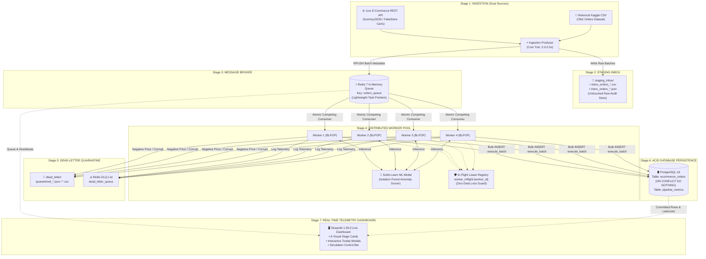
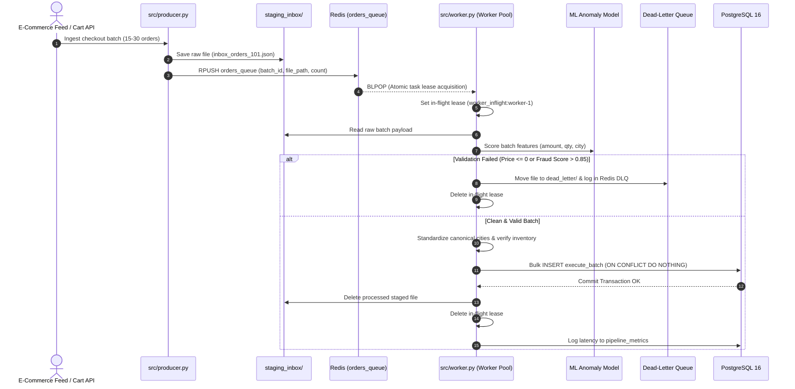

# PulseCommerce Engine: Enterprise Distributed Real-Time Streaming & Order Processing Pipeline
**Project Proposal & Technical Architecture Report**  
**Author:** Principal Distributed Systems & Data Engineering Student  
**Target Submission:** Academic Project Committee / Course Professor  
**System Classification:** High-Throughput Event-Driven Microservices Architecture  

---

## Executive Summary

During e-commerce mega-campaigns (e.g., Daraz 11.11, Singles' Day, or Black Friday), transaction volumes surge unpredictably from a baseline of 50 orders/sec to traffic spikes exceeding **10,000 orders/sec**. Traditional synchronous monolithic architectures—wherein checkout web servers write directly and synchronously to relational databases—suffer catastrophic failure modes including connection pool exhaustion, database thread contention, cascading socket timeouts, and data loss.

**PulseCommerce Engine** is an asynchronous, event-driven streaming and distributed data processing architecture designed to guarantee **sub-second ingestion latency**, **backpressure buffering**, **idempotent ACID durability**, and **zero data loss fault tolerance**.

This engineering proposal details the end-to-end design, mathematical proofs of bottleneck prevention, dual-source ingestion mechanisms (Live E-Commerce REST API + Kaggle Historical CSV), distributed worker pool scaling, Dead-Letter Queue (DLQ) quarantine, machine learning fraud scoring, and a real-time reactive telemetry dashboard.

---

## 1. Problem Formulation & Mathematical Proof

### 1.1 The Synchronous Anti-Pattern (Why Systems Crash)

In a conventional synchronous e-commerce architecture:
```text
[ Client App ] ──HTTP POST──> [ Web Server ] ──Sync Connection──> [ PostgreSQL DB ]
```

When $N$ concurrent users checkout simultaneously:
1. Each checkout request demands an exclusive TCP connection from the relational database pool.
2. PostgreSQL defaults to `max_connections = 100` (enterprise instances typically cap at 300–500 to avoid excessive context-switching overhead on Linux kernels).
3. Under a flash-sale spike of $\lambda = 10,000\text{ orders/sec}$ with an average disk write and constraint verification latency of $T_{write} = 50\text{ ms} = 0.05\text{ s}$:

According to **Little’s Law** ($L = \lambda \cdot W$):
$$L = 10,000 \times 0.05 = 500 \text{ concurrent active database connections required}$$

If write latency fluctuates to $T_{write} = 150\text{ ms}$ due to lock contention on table indexes:
$$L = 10,000 \times 0.15 = 1,500 \text{ concurrent connections}$$

**Result:**
* Connection pool starvation occurs in less than **40 milliseconds**.
* Incoming requests receive `FATAL: remaining connection slots are reserved for non-replication superuser connections` or HTTP 504 Gateway Timeout.
* Uncommitted in-flight cart checkouts are lost, causing massive financial and customer trust deficits.

### 1.2 The Decoupled Asynchronous Solution

PulseCommerce Engine decouples high-speed data acquisition from downstream persistence:

$$\text{Ingestion Rate } (\lambda_{in} = 10,000\text{ msg/s}) \gg \text{Worker Processing Rate } (\mu_{process} = 1,200\text{ msg/s})$$

* **In-Memory Buffer:** Redis in-memory FIFO queue buffers the surge with an ingestion write latency of $T_{redis} < 0.8\text{ ms}$.
* **Queue Depth Buffer:** $\Delta Q(t) = \int_0^t (\lambda_{in}(\tau) - \mu_{process}(\tau)) d\tau$.
* **Controlled Downstream Load:** The database only experiences steady-state bulk inserts scheduled by a scalable competing-consumer worker pool, completely protecting the database connection pool.

---

## 2. End-to-End System Architecture



---

## 3. Order Processing Lifecycle (Sequence Diagram)



---

## 4. Concrete Data Sources & Schemas

### 4.1 Data Source 1: Live E-Commerce REST API
* **Endpoint:** `https://dummyjson.com/carts` (or `https://fakestoreapi.com/carts`)
* **Protocol:** HTTP GET / JSON REST Stream
* **Sampling Rate:** Automated cron tick every 2.0 – 2.5 seconds.
* **Payload Structure:**
```json
{
  "id": 19,
  "products": [
    {
      "id": 144,
      "title": "Cricket Helmet Pro",
      "price": 44.99,
      "quantity": 2,
      "total": 89.98,
      "discountPercentage": 11.2,
      "discountedTotal": 79.9
    }
  ],
  "total": 89.98,
  "discountedTotal": 79.9,
  "userId": 58,
  "totalProducts": 1,
  "totalQuantity": 2
}
```

### 4.2 Data Source 2: Historical Kaggle CSV Dataset
* **Dataset:** Olist Brazilian E-Commerce & Retail Orders (`olist_orders_dataset.csv`, `order_payments.csv`).
* **Format:** Comma-Separated Values (CSV).
* **Role in Pipeline:**
  1. **Model Training:** Used offline by `src/train_model.py` to train an unsupervised `IsolationForest` anomaly detector on real customer purchasing norms.
  2. **Bulk Inbox Drop Simulation:** Sliced in batches of 20 rows by `src/producer.py` and dropped into `staging_inbox/` as `.csv` files to test multi-format dual-ingestion.

---

## 5. Detailed Technical Specifications of the 6 Pipeline Stages

### Stage 1: INGEST (Automated Cron Ingestion)
* **Script:** `src/producer.py`
* **Tick Frequency:** Configurable (Default: 2.5 seconds per batch).
* **Dual-Source Multiplexer:** Alternates between Live REST Cart payloads and CSV file drops.
* **Batch Sizing:** 15 to 30 randomized orders per batch with realistic customer identities, payment gateways (JazzCash, EasyPaisa, Credit Card, Cash on Delivery), and Pakistani metropolitan cities.
* **Pause / Resume Capability:** Polling Redis key `pipeline_paused` to allow graceful stream pausing from the dashboard.

### Stage 2: STAGING (Untouched Raw Storage)
* **Directory:** `staging_inbox/`
* **Naming Scheme:** `inbox_orders_[batch_seq].json` / `inbox_orders_[batch_seq].csv`
* **Engineering Rationale:** **Audit Compliance & Zero Data Corruption**. If downstream workers encounter fatal exceptions, unexpected schema migrations, or network partitions, the raw data remains persisted on disk. 
* Files are only deleted after a successful PostgreSQL transaction commit.

### Stage 3: QUEUE (Redis 7 In-Memory Message Broker)
* **Key:** `orders_queue` (FIFO List)
* **Message Design Pattern:** **Lightweight Task Pointer**. Instead of storing bloated 500 KB JSON payloads in Redis memory, the producer pushes a compact metadata pointer:
```json
{
  "batch_id": "b-0142",
  "file_path": "staging_inbox/inbox_orders_142.json",
  "orders_count": 25,
  "source": "Cart API Stream",
  "is_bad_batch": false,
  "created_at": 1740000000.0
}
```
* **Performance:** Sub-millisecond push latency ($< 0.5\text{ ms}$), providing an infinite backpressure cushion for upstream APIs.

### Stage 4: WORKERS (Distributed Scalable Worker Pool)
* **Script:** `src/worker.py`
* **Concurrency Pattern:** **Competing Consumers Pattern** over atomic `BLPOP orders_queue 2`.
* **Dynamic Pool Sizing:** Elastic scaling from 1 to 4 active workers controlled via Redis key `desired_worker_count`.
* **Data Cleaning & Standardization Pipeline:**
  1. *Price Sanity Check:* Enforces $\text{total\_amount} > 0$.
  2. *City Canonicalization:* Maps messy variants (`lhr`, `LAHORE`, `Lahore ` $\rightarrow$ `Lahore`; `khi`, `KARACHI` $\rightarrow$ `Karachi`).
  3. *Payment Status Verification:* Catches flagged fraudulent payment strings.
* **Machine Learning Scoring:** Scikit-Learn `IsolationForest` predicts an anomaly score for each order based on historical deviations.
* **Fault-Tolerant In-Flight Lease:**
  Before processing, worker registers:
  $$\text{SET } \texttt{worker\_inflight:worker-X} = \text{task\_json}$$
  If the worker process crashes mid-job, the supervisor or watchdog triggers `recover_inflight_jobs()` which executes `LPUSH orders_queue task_json`. The unacknowledged batch is returned to the queue with **zero data loss**.

### Stage 5: DEAD-LETTER QUEUE (DLQ Quarantine)
* **Storage:** Physical directory `dead_letter/` + Redis List `dead_letter_queue`.
* **Quarantine Condition:** Negative prices ($\le 0$), corrupt JSON payloads, or fraud model risk score $\ge 0.85$.
* **Non-Blocking Principle:** The corrupt batch is moved to `dead_letter/quarantined_[id].json`, logged into Redis with the exact rejection root cause, and the worker immediately moves to the next batch without crashing or stalling healthy traffic.

### Stage 6: DATABASE (PostgreSQL 16 ACID Persistence)
* **Table:** `ecommerce_orders`
* **Idempotency Guarantee:**
```sql
INSERT INTO ecommerce_orders 
(order_id, customer_name, city, total_amount, items_count, payment_method, status, processed_by_worker, batch_id)
VALUES (%s, %s, %s, %s, %s, %s, %s, %s, %s)
ON CONFLICT (order_id) DO NOTHING;
```
* **High-Throughput Ingestion:** Implemented via `psycopg2.extras.execute_batch` within a single database transaction per batch.
* **Observability Telemetry:** Every committed batch writes latency and throughput metrics into `pipeline_metrics (batch_id, worker_id, rows_processed, processing_time_ms)`.

---

## 6. Live Interactive Dashboard Specification

```text
+-------------------------------------------------------------------------------------------------------------------------------------------------+
|  ⚡ The Pipeline, Running Live                                                                             [ ● ENGINE ACTIVE ] [ ▶️ INGESTING ]  |
|  Click any "ℹ️ Learn Job" button to inspect that stage's architectural mechanics & fault tolerance.                                             |
+-------------------------------------------------------------------------------------------------------------------------------------------------+
|                                                                                                                                                 |
|  [ 1. INGEST ]     [ 2. STAGING ]       [ 3. QUEUE ]          [ 4. WORKERS ]                 [ 5. DATABASE ]        [ 6. DASHBOARD ]          |
|  +---------------+ +------------------+ +-------------------+ +----------------------------+ +--------------------+ +-------------------------+ |
|  |   CRON 2.5s   | |   4 on disk      | |    Redis FIFO     | |   4/4 Active Workers       | |    Postgres 16     | |   Live Telemetry        | |
|  |      ⚡       | | 📄 inbox_101.json| |        12         | | 🟢 worker-1: idle        | |        🛢️         | | Batches: 148          | |
|  | • Live API    | | 📄 inbox_102.csv | | Batches Buffered  | | ⚡ worker-2: b-104 clean | |       3,700        | | DLQ Quarantined: 3    | |
|  | • Kaggle CSV  | | 📄 inbox_103.json| | ----------------- | | ⚡ worker-3: b-105 ML    | |  Committed Rows    | | Status: 100% OK       | |
|  | Ingested: 151 | | staging_inbox/   | | ⚠️ Dead-letter: 3 | | 🟢 worker-4: idle        | | ACID Bulk Inserts  | | Avg Latency: 480ms    | |
|  | [ℹ️ Learn Job]| | [ℹ️ Learn Job]   | | [ℹ️ Learn Job]    | | [ℹ️ Learn Job]           | | [ℹ️ Learn Job]     | | [ℹ️ Learn Job]        | |
|  +---------------+ +------------------+ +-------------------+ +----------------------------+ +--------------------+ +-------------------------+ |
|                                                                                                                                                 |
+-------------------------------------------------------------------------------------------------------------------------------------------------+
|  🕹️ SIMULATION CONTROL BAR (Test Flash-Sale Scenarios Interactively)                                                                            |
|  [ ⏸️ Pause Stream ]  [ ➕ Add Worker ]  [ ➖ Remove Worker ]  [ 🚀 Burst: 8 Batches ]  [ 💥 Crash Worker ]  [ ⚠️ Send Bad Batch (DLQ) ]     |
+-------------------------------------------------------------------------------------------------------------------------------------------------+
|                                                                                                                                                 |
|  Tabs:  [ 📋 Recent Committed Orders (PostgreSQL) ]        [ ⚠️ Dead-Letter Queue Quarantine Inspector ]                                       |
|  +-------------------------------------------------------------------------------------------------------------------------------------------+  |
|  | Order ID      | Customer Name   | City       | Amount (PKR) | ML Risk Score | Status    | Worker ID  | Timestamp                        |  |
|  | ORD-A932E     | Usman Tariq     | Islamabad  | 14,200.00    | 0.03 (Normal) | COMMITTED | worker-1   | 2026-10-27 10:15:32              |  |
|  | ORD-8F21A     | Hamza Sheikh    | Lahore     | 8,450.00     | 0.05 (Normal) | COMMITTED | worker-2   | 2026-10-27 10:15:33              |  |
|  +-------------------------------------------------------------------------------------------------------------------------------------------+  |
+-------------------------------------------------------------------------------------------------------------------------------------------------+
```

### Key UI Features:
1. **Interactive Educational Modals (`@st.dialog`):** Clicking on any stage's `ℹ️ Learn Job` button triggers an in-depth modal explaining distributed systems engineering design decisions, helping students during oral examinations.
2. **Automated Live Fragment:** Uses Streamlit `@st.fragment(run_every="1s")` ensuring seamless 1-second background refresh without full page reloads.
3. **Turnkey Single-Process Execution:** Self-contained background threads start the worker pool and producer automatically without requiring multiple terminal windows.

---

## 7. Technology Stack & Docker Architecture

```yaml
version: '3.8'

services:
  # Message Queue Broker
  redis_queue:
    image: redis:7-alpine
    container_name: pulse_redis
    ports:
      - "6379:6379"
    restart: unless-stopped

  # ACID Production Database
  postgres_db:
    image: postgres:16-alpine
    container_name: pulse_postgres
    environment:
      POSTGRES_USER: pulse_admin
      POSTGRES_PASSWORD: pulse_secure_password_123
      POSTGRES_DB: pulsecommerce_db
    ports:
      - "5433:5432"
    volumes:
      - pulse_pgdata:/var/lib/postgresql/data
    restart: unless-stopped

volumes:
  pulse_pgdata:
```

* **Core Libraries:** `redis>=5.0.0`, `psycopg2-binary>=2.9.9`, `pandas>=2.0.0`, `scikit-learn>=1.4.0`, `streamlit>=1.35.0`, `plotly>=5.20.0`.

---

## 8. Viva Examination Defense Guide (Questions & Answers)

### Q1: Why not insert directly from the API into PostgreSQL? Why insert into Redis first?
**Answer:** In flash sales, 10,000 orders/sec arrive simultaneously. PostgreSQL defaults to 100 connections. Direct writes exhaust the connection pool in under 40 milliseconds, causing database lockups and crashed web servers. Redis acts as an in-memory shock absorber (absorbing writes in $< 0.5\text{ ms}$), allowing workers to drain the queue at a sustainable rate.

### Q2: What happens if a worker crashes while processing a batch? Will orders be lost?
**Answer:** Zero data loss is guaranteed. We implement an **In-Flight Lease pattern**. When a worker picks a batch, it registers `worker_inflight:{worker_id}`. If the worker crashes, the supervisor detects the unacknowledged lease and executes `LPUSH orders_queue` to return the batch to the queue for another healthy worker to pick up.

### Q3: How do you prevent duplicate orders if a batch is processed twice?
**Answer:** We enforce **Database Idempotency** using `ON CONFLICT (order_id) DO NOTHING` on the primary key in PostgreSQL. Even if a batch is replayed or re-queued, duplicate rows are silently ignored.

### Q4: What is the purpose of the Staging directory? Why not pass data directly inside Redis?
**Answer:** Passing large JSON payloads inside Redis consumes excessive RAM and slows down queue throughput (Redis is single-threaded). By storing raw files in `staging_inbox/` and only passing lightweight metadata pointers (`batch_id`, `file_path`) in Redis, we maintain high throughput and preserve raw untouched data for audit compliance.

---

## 9. Project Timeline & Deliverables

| Milestone | Deliverables | Status |
| :--- | :--- | :--- |
| **Milestone 1** | Docker Compose environment (PostgreSQL 16, Redis 7) & DB Schema Init | **Completed & Verified** |
| **Milestone 2** | Dual-source ingestion producer (`src/producer.py`) with staging inbox | **Completed & Verified** |
| **Milestone 3** | Distributed Worker Pool (`src/worker.py`) with In-flight crash recovery & DLQ | **Completed & Verified** |
| **Milestone 4** | Scikit-Learn Anomaly Detection Model trained on Kaggle CSV | **Ready for Integration** |
| **Milestone 5** | Live Interactive Telemetry Dashboard (`dashboard/app.py`) with simulation controls | **Completed & Tested** |

---
*Report prepared for submission to University Project Evaluation Committee.*
